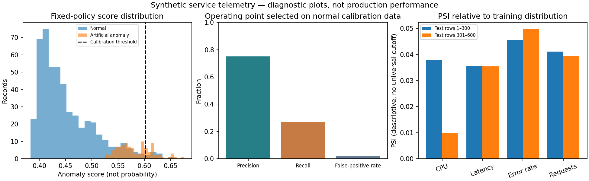
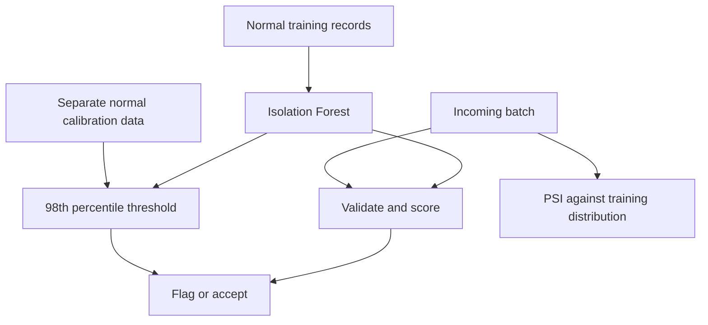

# Telemetry Anomaly Detection & Drift Reports

Detect unusual service telemetry using **Isolation Forest**, a threshold calibrated on separate normal data, and **population stability index (PSI)** reports for incoming batches.

The project demonstrates unsupervised scoring, leakage checks, threshold tradeoffs, JSON APIs and descriptive explanations. An alert is a candidate for investigation, not a diagnosis of an outage.

[](https://github.com/ayanirfan099/telemetry-anomaly-ai/actions/workflows/tests.yml)




The fixed 98th-percentile calibration policy has 75% precision and 27% recall on the bundled synthetic test data. The graphic shows that operating point without optimizing on test labels. PSI is descriptive. Reproduce with `python -m pip install matplotlib`, then `python scripts/plot_diagnostics.py`.

## Features and flow

Input features are `cpu_percent` (0–100), `latency_ms` (non-negative), `error_rate` (fraction 0–1) and `requests_per_minute` (non-negative).



The `is_anomaly` labels are used only for evaluation, never as model inputs. The model is fitted in memory on startup, so no externally supplied serialized model is loaded. A dataset/parameter fingerprint identifies this demo model configuration.

## Try it

```sh
python app.py evaluate
python app.py serve --port 8003
```

Send `POST http://127.0.0.1:8003/predict` with `Content-Type: application/json`:

```json
{"records":[{"cpu_percent":99,"latency_ms":900,"error_rate":0.7,"requests_per_minute":2000}]}
```

Each response includes anomaly scores, flags, the threshold and the two largest deviations from normal training medians. These deviations are descriptive statistics, not causal or SHAP explanations. Anomaly scores are not probabilities. Batches with at least 20 records also receive per-feature PSI values; smaller batches return null for PSI. Interpret small-batch estimates cautiously; no universal drift alarm cutoff is claimed.

## Reproducible data and results

The repository includes **1,000 training**, **300 calibration** and **600 test** records generated with separate fixed random seeds. The test set contains 500 normal and 100 artificial anomalies. `generate_data.py` regenerates all CSVs. These are fictional telemetry records, not logs from a real service. The normal-data assumption for calibration is intentional and may not hold in production.

The committed report records:

| Metric | Demo result |
| --- | --- |
| ROC AUC | 0.96092 |
| Average precision | 0.73704 |
| Precision at the fixed threshold | 75% |
| Recall at the fixed threshold | **27%** |
| False-positive rate | 1.8% |

**The conservative threshold misses 73 of the 100 synthetic anomalies.** This is a meaningful limitation, not a production-ready detector. High AUC does not imply high recall at the chosen operating threshold. Threshold changes should be selected against a separate validation set and a defined alert budget, not optimized on the test labels.

## Files

- `generate_data.py`: deterministic synthetic-data generation.
- `model.py`: schema validation, model fitting, threshold calibration, scoring, PSI and evaluation.
- `app.py`: CLI and API.
- `data/`: independent train, calibration and test CSVs.
- `reports/evaluation.json`: metrics and confusion matrix.
- `tests/`: invalid inputs, split overlap, extremes and drift checks.

## Next engineering milestones

Use permissioned historical telemetry, time-based splits and incident labels. Add seasonal/time-window features and a validation-based alert-budget policy. Compare statistical and supervised baselines. Track delayed incident feedback, drift and retraining; never automatically restart or block services solely because this demo raises an alert.

Reference: [scikit-learn IsolationForest](https://scikit-learn.org/stable/modules/generated/sklearn.ensemble.IsolationForest.html).

## Quick start

Tested with Python 3.12. Use a separate virtual environment for each project:

```sh
python -m venv .venv
# Windows PowerShell: .venv\Scripts\Activate.ps1
# macOS/Linux: source .venv/bin/activate
python -m pip install -r requirements.txt
python -m unittest discover -s tests -v
python app.py evaluate
```

The dependencies are pinned to the versions tested for this project, not advertised as the newest versions. After the first dependency installation, the bundled examples run offline. No paid API keys or external model downloads are needed.

The lightweight HTTP server is for local demonstrations. It binds to localhost, accepts JSON only, limits request size and does not log request bodies. Authentication, production serving, rate limiting and operational monitoring must be added before public deployment. The included GitHub Actions workflow runs tests and evaluation when pushed to a repository; check the linked Actions badge for current remote status.
